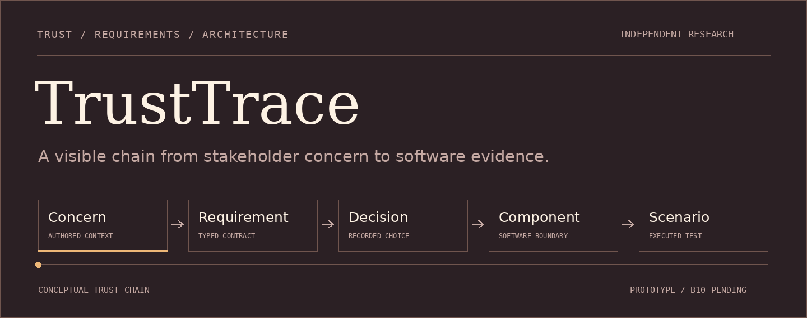

<p align="center">
  
</p>

<p align="center">
  <a href="#quick-start">Run the prototype</a> &nbsp;·&nbsp;
  <a href="#what-is-tested">Explore the evidence</a> &nbsp;·&nbsp;
  <a href="#the-research-track">Read the protocol</a> &nbsp;·&nbsp;
  <a href="docs/assets/readme/hero-static.png">View still artwork</a>
</p>

# Trace a concern into a tested design

TrustTrace connects stakeholder trust concerns to requirements, architecture choices and executable scenarios in an authored logistics case. Its central question is practical: **can a reader follow the evidence behind a design choice, and see where that evidence stops?**

**Python 3.12** · **Pydantic metamodel** · **FastAPI mock demo** · **uv lockfile**

> **Current scope:** an independent engineering foundation. The case is synthetic, the demo uses a deterministic mock, and the B10 elicitation experiment has not run. Human labels and design review are pending.

## What is tested

<table>
<tr>
<td width="50%" valign="top">
<h3>Traceable by construction</h3>
<p>Typed actors, scopes, conditions, risks and evidence links expose dangling references. Decision documents and evidence paths must resolve inside the repository.</p>
<p><a href="src/trusttrace/models.py">Metamodel</a> · <a href="src/trusttrace/trace.py">Trace verifier</a> · <a href="data/metamodel.schema.json">JSON Schema</a></p>
</td>
<td width="50%" valign="top">
<h3>Bounded software behaviour</h3>
<p>Executed scenarios check selective sharing, mandatory review, citation membership, tenant-scoped retrieval, document consistency and audit-chain verification.</p>
<p><a href="tests/scenarios/test_boundaries.py">Scenario tests</a> · <a href="docs/architecture.md">Architecture</a> · <a href="docs/adr/adr-001.md">Decision records</a></p>
</td>
</tr>
</table>

| Evidence as of 14 October 2026 | What it establishes |
| :--- | :--- |
| **35 passing software tests** | Verified code behaviour at the [tested milestone commit](https://github.com/Agent007repo/trusttrace/actions/runs/38505114650). |
| **16 / 16 must requirements traced** | Each has a valid source, decision, component and passing requirement-marked scenario. |
| **40 authored requirements, 8 stakeholder roles** | A synthetic design catalogue. Its **24 should requirements are unimplemented** and remain visible beside the tested slice. |

[Raw checks and source hashes](results/raw/software-checks/2026-10-14-verification.json) · [Traceability report](results/derived/traceability.json) · [Multi-party case](docs/case/2026-10-14-multi-party.md)

Coverage of the must slice does not establish ecosystem trustworthiness. Citation membership does not prove semantic support. The audit chain detects changes against a retained anchor; no external checkpoint service is implemented.

## Quick start

Use Python 3.12 and `uv` from the repository root:

```bash
make setup                 # Sync the committed lockfile
make test                  # Lint, format, strict typing, tests and integrity
make analyze               # Regenerate readiness and engineering traces
uv run uvicorn trusttrace.app:app --host 127.0.0.1 --port 8000
```

The local demo retrieves original synthetic passages and queues mock suggestions for human review. It has one synthetic tenant, in-memory state and no authentication or real model integration. See the [architecture boundaries](docs/architecture.md) before treating it as an application service. Docker configuration is prepared; container execution remains unverified.

<details>
<summary><strong>More useful commands</strong></summary>

```bash
uv run trusttrace validate       # Validate the authored case
uv run trusttrace trace          # Join the case to an executed JUnit report
uv run trusttrace prepare-b10    # Offline prerequisite report; exit 2 means blocked
make docs                       # Build the documentation with strict checks
make report                     # Build the existing LaTeX report skeleton
```

`make report` requires a LaTeX installation. `make bench-full` deliberately refuses collection in the current state. No paid provider is enabled.

</details>

## The research track

B10 will compare naive, metamodel-guided and retrieval-assisted elicitation under the [immutable initial protocol](PREREGISTRATION.md). The intended source set is 12 synthetic inputs plus 12 verified legal excerpts, with at least two model families and human-adjudicated matching.

| Prepared | Still required before collection |
| :--- | :--- |
| [Dated execution appendix](docs/protocols/2026-10-14-b10-execution-appendix.md), draft prompts and output schema | Human review, verified runtime artifacts and an independent retrieval freeze |
| [Two pinned model-family candidates](docs/protocols/2026-10-14-model-shortlist.md) | Remaining licence checks, local backend and conversion/tokenizer hashes |
| [12 unlabelled synthetic inputs](data/synthetic_annotation_inputs.jsonl), checksum-bound annotation tooling | 12 eligible legal inputs, human gold, complete ledger capture and scoring |

**Collection remains disabled.** GDPR retrieval, current eFTI consolidation and full EUR-Lex reuse verification remain incomplete. Specific ISO characteristic mappings remain unverified. The [source register](docs/sources.json) and [dated verification record](docs/protocols/2026-10-14-source-verification.md) preserve these limits.

## Open the project

| Start with | Then explore |
| :--- | :--- |
| [Research questions](docs/research-questions.md) and [method](docs/method.md) | [Architecture](docs/architecture.md), [case](data/synthetic_case.yaml) and [decisions](docs/adr/) |
| [Reproduction guide](docs/reproduce.md) | [Tests](tests/), [raw evidence](results/raw/software-checks/) and [derived artifacts](results/derived/) |
| [Status](STATUS.md) and [limitations](docs/limitations.md) | [Related work](docs/related-work.md) and [report skeleton](paper/report.tex) |

## Authorship and reuse

AI coding assistants prepared code, documentation and original README artwork from Samarth's research brief. Samarth's human labels, design review and final prose review are pending. No practitioner validation or research findings are claimed; the report is still a one-page skeleton.

This independent project has no affiliation with or endorsement from TU/e, TU Delft, TNO, LLM4LM or f-inference. It uses no internal material. Code is under [Apache-2.0](LICENSE); documentation is under [CC BY 4.0](LICENSE-docs). External material retains its own terms, recorded in [THIRD_PARTY.md](THIRD_PARTY.md).

---

**Companion project:** [ContinuumBench](https://github.com/Agent007repo/continuum-bench) studies measurement and model placement. No measured cross-project finding exists yet.

<sub>The cover illustrates the trust chain and stops after two animation cycles. It contains no experiment data. [Artwork source and rendering notes](tools/readme-art/README.md).</sub>
