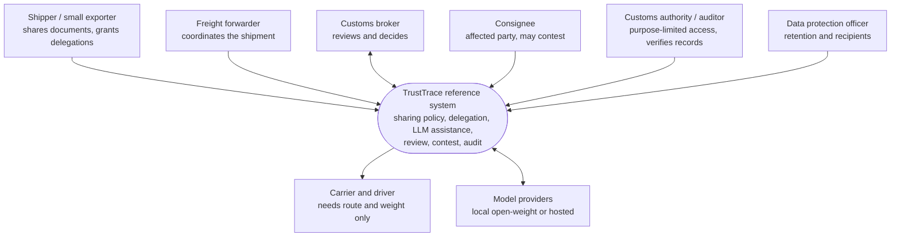
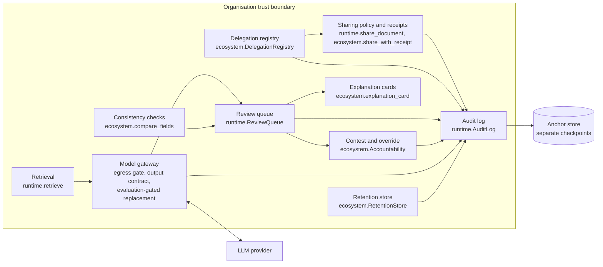

# Architecture

The reference implementation is a small, in-process Python system that makes the trust chain executable. It is synthetic: one machine, no real tenants, no authentication, no customs submission. Its job is to show that each requirement can be turned into a component and a test, not to be deployed.

## System context (C4 level 1)

## Containers and components (C4 level 2)

Arrows show the main data flow. Every component that changes state writes to the audit log, and the log is checkpointed to a separate anchor store (ADR-015).

## Where each decision lives

| Component | Code | Decisions | Patterns |
|---|---|---|---|
| Sharing policy and receipts | `runtime.share_document`, `ecosystem.share_with_receipt` | ADR-001, ADR-007 | P1, P6 |
| Delegation registry | `ecosystem.DelegationRegistry` | ADR-006 | P5 |
| Retrieval and citations | `runtime.retrieve`, `runtime.validate_suggestion` | ADR-003 | P3 |
| Model gateway | `ecosystem.ModelGateway`, `ecosystem.validate_output_contract` | ADR-010, ADR-011, ADR-012 | P8, P9, P10 |
| Review queue | `runtime.ReviewQueue` | ADR-002 | P2 |
| Contest and override | `ecosystem.Accountability` | ADR-009 | P7 |
| Explanation cards | `ecosystem.explanation_card` | ADR-013 | P3 |
| Consistency checks | `runtime.differences`, `ecosystem.compare_fields` | ADR-005, ADR-014 | (none) |
| Retention | `ecosystem.RetentionStore` | ADR-008 | (none) |
| Audit and persistence | `runtime.AuditLog`, `ecosystem.AnchorStore`, `ecosystem.save_queue` | ADR-004, ADR-015 | P4 |

## Deliberate limits

- The local FastAPI demo (`app.py`) serves one synthetic tenant on loopback with a deterministic mock model. The ecosystem controls are a library exercised by tests, not yet wired into the HTTP demo.
- We implement a typed Python policy rather than Open Policy Agent because the rules are few and must fail visibly in unit tests. OPA remains an option if rules grow.
- The anchor store is a separate file on the same host. A real deployment needs a different administrative domain or a transparency log.
- Delegation expiry trusts the caller's clock. Clock skew between organisations is out of scope.
- Two of 40 requirements remain unimplemented: TR-017 and TR-018 need verified legal sources, which are still blocked.

See [conflicts and trade-offs](conflicts.md) for the conflict matrix and softgoal graph, and the [pattern catalogue](patterns.md) for reusable solutions.
