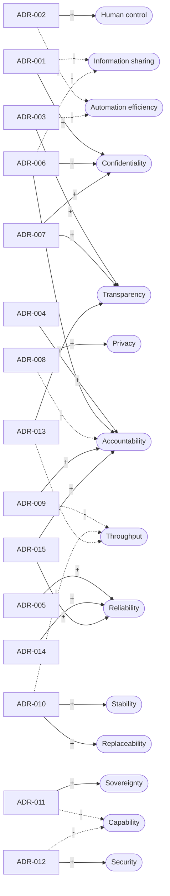

# Conflicts and trade-offs

Generated by `scripts/render_conflicts.py` from `data/synthetic_case.yaml`. The conflicts are authored analysis of a synthetic case, not findings from practitioners.

## Conflict matrix

| Conflict | Tension | Requirements | Resolved by | Residual cost (from the decision record) |
|---|---|---|---|---|
| CONFLICT-01 | Source transparency versus confidential field exposure | TR-001, TR-009 | [ADR-001](adr/adr-001.md) | New fields require an explicit policy change. |
| CONFLICT-02 | Fast automation versus human authority | TR-003, TR-004 | [ADR-002](adr/adr-002.md) | We add review effort and cannot measure its impact without practitioners. |
| CONFLICT-03 | Information sharing for coordination versus confidentiality of commercial data | TR-021, TR-022, TR-023, TR-027, TR-040 | [ADR-006](adr/adr-006.md) | Each new shipment needs a grant, which adds friction for high-volume forwarders. |
| CONFLICT-04 | Auditability and durable evidence versus data minimisation and retention limits | TR-028, TR-020 | [ADR-008](adr/adr-008.md) | Which metadata is lawful to keep, and for how long, is a legal question we have not answered. |
| CONFLICT-05 | Accountability and contestability versus processing throughput | TR-029, TR-037 | [ADR-009](adr/adr-009.md) | More records slow throughput and add reviewer work. |
| CONFLICT-06 | Provider replaceability (sovereignty) versus stable validated behaviour | TR-019, TR-031, TR-032 | [ADR-010](adr/adr-010.md) | An output-contract test checks shape, not quality. |
| CONFLICT-07 | Model capability of external providers versus data sovereignty | TR-036 | [ADR-011](adr/adr-011.md) | Approval is a declared attribute, not verified residency. |

## Softgoal contribution graph

Decisions (boxes) help (+) or hurt (-) quality softgoals (rounded). This follows the spirit of softgoal interdependency graphs in the NFR framework (Chung et al., 2000). Contributions are our qualitative judgement and are open to challenge in the practitioner study.

## Decision index

| Decision | Title |
|---|---|
| [ADR-001](adr/adr-001.md) | Use an allowlist for partner payloads |
| [ADR-002](adr/adr-002.md) | Require review for every compliance suggestion |
| [ADR-003](adr/adr-003.md) | Validate citations against retrieved passage IDs |
| [ADR-004](adr/adr-004.md) | Verify hash chains against a separate anchor |
| [ADR-005](adr/adr-005.md) | Begin with deterministic consistency checks |
| [ADR-006](adr/adr-006.md) | Grant access through purpose-bound, expiring delegations |
| [ADR-007](adr/adr-007.md) | Version the sharing policy and give owners disclosure receipts |
| [ADR-008](adr/adr-008.md) | Purge content at retention expiry, keep a hash and lifecycle metadata |
| [ADR-009](adr/adr-009.md) | Make contests and overrides first-class audited records |
| [ADR-010](adr/adr-010.md) | Gate provider and version changes on evaluation and a recorded decision |
| [ADR-011](adr/adr-011.md) | Gate raw-document egress by provider approval |
| [ADR-012](adr/adr-012.md) | Treat model and retrieved text as data, never as commands |
| [ADR-013](adr/adr-013.md) | Separate quoted source text from generated interpretation |
| [ADR-014](adr/adr-014.md) | Compare quantities with units and keep absence distinct from zero |
| [ADR-015](adr/adr-015.md) | Persist state atomically and checkpoint the log to a separate anchor store |
